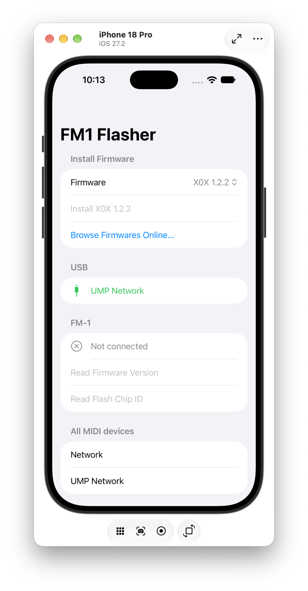
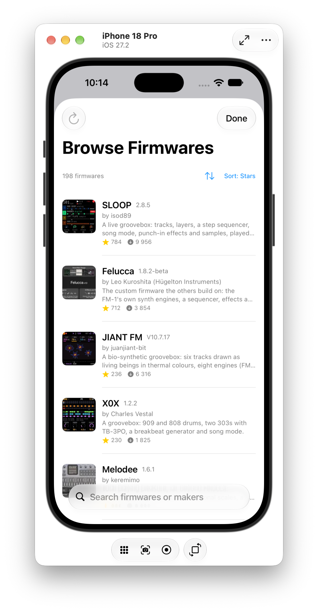
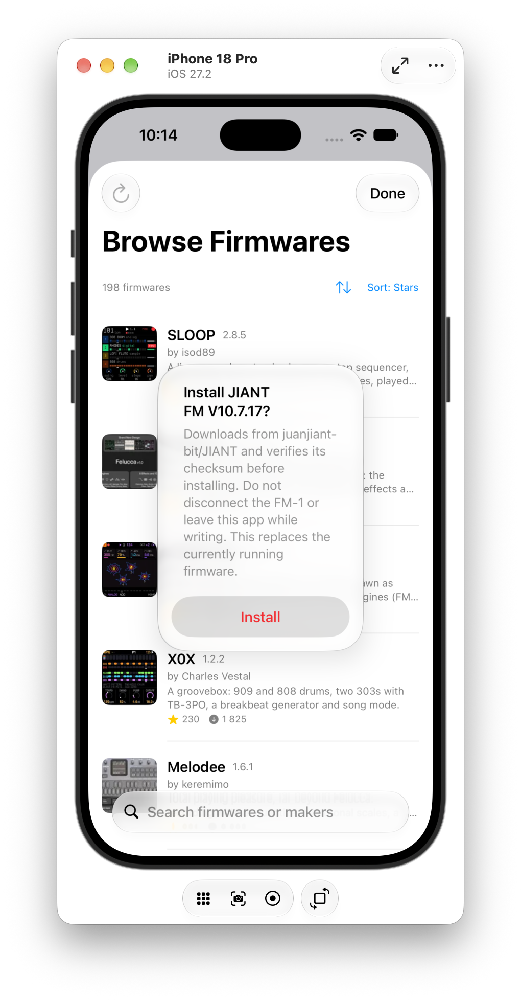

# FM1 Flasher

## TL;DR

Use your iPhone to flash FM-1 firmware, as in thefirmwarehub.com.

A native iOS app for flashing community firmware onto the Vave FM-1, over
USB MIDI, directly from an iPhone or iPad — no laptop or Chrome/Web MIDI
required.

> **⚠️ Early-stage experiment.** This is a personal project, used only by
> its author, not a published or reviewed app. It talks directly to FM-1
> hardware over a reverse-engineered protocol and can leave a device in an
> unexpected state if something goes wrong mid-install (see `PLAN.md` for
> the known risks and mitigations). There is no App Store / TestFlight
> distribution yet, and the rough edges below are expected to be resolved
> before that ever happens — don't treat this as a finished or supported
> tool.

See [`PLAN.md`](PLAN.md) for the full technical writeup: protocol
reverse-engineering notes, hardware/connectivity requirements, and
known bricking risks and mitigations.

  
  
  

## Firmware packages aren't in this repo

`FM1Flasher/Firmware/*.fwsc` is gitignored. Those are community firmware
builds from other developers, not this project's own code, and this repo
doesn't redistribute them. The app's own in-app "Browse Firmwares Online"
screen fetches them straight from
[thefirmwarehub.com](https://thefirmwarehub.com)'s public catalog at
runtime instead.

If you want a local bundled copy for offline testing (`FirmwareCatalog.swift`),
download the `.fwsc` files you want from thefirmwarehub.com or the
relevant project's own GitHub releases and drop them into
`FM1Flasher/Firmware/` yourself.

## Building

1. `brew install xcodegen` (if you don't have it)
2. `xcodegen generate`
3. Open `FM1Flasher.xcodeproj` in Xcode and pick your own team under
   Signing & Capabilities (not stored in the project; XcodeGen
   regenerates the project file, so re-select it after any
   `xcodegen generate`), or build from the command line with
   `xcodebuild ... DEVELOPMENT_TEAM=<your team ID>`.
